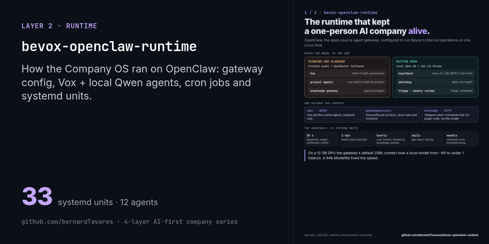
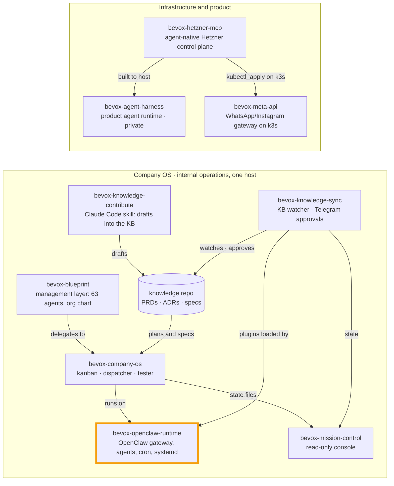

# bevox-openclaw-runtime

[](./LICENSE.md)  



> Part of the [4-layer AI-first company series](https://github.com/bernardTavares) ([how the repos fit together](#how-the-repos-fit-together)). License: FSL-1.1-MIT (source-available, converts to MIT after 2 years)

How Bevox ran **[OpenClaw](https://openclaw.ai)**, the open-source, self-hosted agent gateway, as the operating layer of a one-person AI company:
- the gateway configuration;
- the agents and their personas;
- the cron jobs;
- the systemd units that kept everything alive on one Linux host.

OpenClaw itself is **not** in this repo. This is configuration and agent definitions only.

It's the runtime half of the Company OS. The code that ran on it is public too:

| Repo | What it is |
|---|---|
| [bevox-company-os](https://github.com/bernardTavares/bevox-company-os) | Kanban, dispatcher, tester, clarification, scrum-master, delivery, health, cost and finance modules. Its `CLAUDE.md` holds the doctrine: "Claude Code codes · OpenClaw operates · the knowledge base decides". |
| [bevox-knowledge-sync](https://github.com/bernardTavares/bevox-knowledge-sync) | The knowledge-base skill and the Telegram approval plugins loaded by this gateway |
| [bevox-mission-control](https://github.com/bernardTavares/bevox-mission-control) | The console that reads this runtime |
| [bevox-knowledge-contribute](https://github.com/bernardTavares/bevox-knowledge-contribute) | The Claude Code skill on the other side of the knowledge base |

> **Status:** this ran Bevox's internal operations on a single host. It's published as a reference: a real, working OpenClaw setup, with secrets, chat IDs, agent memory and session history removed. The agent texts are in Portuguese.

## What's inside

```
config/openclaw.example.json   gateway config: agents, models, fallbacks, channels, hooks, plugins
agents/<id>/                   persona and operating files per agent (SOUL, AGENTS, IDENTITY, TOOLS, HEARTBEAT, BOOT)
cron/jobs.json                 OpenClaw cron jobs (agent turns on a schedule)
systemd/                       19 services + 14 timers, plus drop-in overrides (gateways, dispatcher, reaper, health, cost, knowledge)
modelfiles/                    the Ollama Modelfile for the local 64k-context model
scripts/telegram-send.sh       small helper for sending to Telegram from shell jobs
```

### Agents

| Agent | Model | Role |
|---|---|---|
| `main` (**Vox**) | `openai-codex/gpt-5.4`, with OpenRouter fallbacks (Qwen, DeepSeek) | Digital chief of staff and main orchestrator. Its `SOUL.md` and `AGENTS.md` are the most complete persona here. |
| `vox-local` | `ollama/qwen3:14b` | Vox on a local model |
| `healthcheck-light`, `heartbeat-light` | `ollama/qwen3` (14b / 4b) | Silent operational checks; reply `NO_REPLY` unless something matters |
| `watchdog-light` | `ollama/qwen3:4b` | Daily cron-health watchdog |
| `weekly-review-agent` | `ollama/qwen3:14b` | Weekly system-performance review |
| `triage-agent` | `ollama/qwen3:4b` | Lightweight triage |
| `project-bevox-*` | per project | One "chief of staff" per product project. Each has the shared operating rules, the knowledge-integration and clarification contracts, and two skills: `project-framing` and `spec-writer`. |

Honest note: several light agents (healthcheck, watchdog, memory-consolidation) still carry OpenClaw's default `IDENTITY.md` template. Their behavior comes from the cron job prompts, not from a persona.

### Topology

- **One gateway per context.** The main gateway runs on `:18789`, a dedicated `knowledge` gateway (the approval plugins) on `:18797`, and per-project gateways via the template unit `openclaw-gateway@.service` (`openclaw --profile %i gateway`). The main gateway binds to loopback only.
- **Cheap models for routine work.** Heartbeats, watchdogs and reviews run on local Qwen models through Ollama. Only the orchestrator uses a frontier model.
- **Deterministic paths where it matters.** Approvals, clarifications and unblocks are Telegram slash commands from plugins (`knowledge-sync-commands`, `clarification-commands`), so they never go through the model.

### Cron jobs (OpenClaw)

| Job | Agent | Schedule |
|---|---|---|
| `healthcheck:operational-check` | heartbeat-light | every 4 h |
| `watchdog:cron-health` | watchdog-light | daily 08:00 |
| `review:weekly-system-performance` | weekly-review-agent | Sundays 18:00 |
| `watchdog:memory-script-execution` | main | daily 20:30 |
| `cron-dispatcher:30s-poll` | main | disabled (replaced by the systemd dispatcher timer) |

### systemd timers

Every 10 s:
- the cron dispatcher (via drop-in);
- the reaper (via drop-in);
- the clarification notifier (via drop-in).

Every 2 min:
- health check;
- health alert.

Hourly:
- cost collector and cost alerts;
- finance snapshot;
- hardening tracker;
- knowledge watcher.

Daily: knowledge gap report and backup.

Weekly: knowledge retirement scan and threshold tune-suggest.

The scripts these units call live in [bevox-company-os](https://github.com/bernardTavares/bevox-company-os).

## Using it

This is a reference, not an installer. To reuse parts of it:

1. Install OpenClaw and run its setup once.
2. Copy `config/openclaw.example.json` to `~/.openclaw/openclaw.json` and adjust:
   - agents and models;
   - `channels.telegram.allowFrom`;
   - the auth profiles.
3. Put secrets in `~/.openclaw/.env`; the units load it with `EnvironmentFile`. That includes `OPENCLAW_GATEWAY_TOKEN`, `TELEGRAM_BOT_TOKEN`, `TELEGRAM_CHAT_ID` and the provider keys.
4. Copy an agent folder into its workspace (for example `~/.openclaw/workspace` for `main`).
5. Copy the units you want to `~/.config/systemd/user/`, then run `systemctl --user daemon-reload` and enable the timers. Paths use `%h`.
6. For the local model: `ollama create qwen3:14b-64k -f modelfiles/qwen3-14b-64k.Modelfile`. Lesson learned: don't let the gateway size the context window to its 256k default on a 12 GB GPU, because throughput dropped from about 65 to under 1 token/s.

## What was removed for this release

- Credentials, auth profiles, the device identity and paired devices.
- Telegram bot tokens, chat and group IDs (now placeholders or `.env`), and the owner's email.
- Agent memory, `USER.md` files, session transcripts, uploaded media, and run outputs.
- Gateway config backups and runtime state (`*.jsonl`, `state.json`, Telegram offsets).

The private repo's history is not included: this is a fresh export.

## How the repos fit together

This repo is one piece of Bevox's public code. The repos form two systems: the **Company OS**, which ran Bevox's internal operations on one host on top of OpenClaw, and the **infrastructure** the product was built to run on.



| Repo | Role | Runs with |
|---|---|---|
| [bevox-openclaw-runtime](https://github.com/bernardTavares/bevox-openclaw-runtime) | OpenClaw gateway config, agents (Vox + local Qwen), cron jobs, systemd units | everything in the Company OS runs on it |
| [bevox-company-os](https://github.com/bernardTavares/bevox-company-os) | Supervised agents: plan → kanban → headless Claude Code → tester → Telegram | runtime, mission-control, knowledge-sync |
| [bevox-mission-control](https://github.com/bernardTavares/bevox-mission-control) | Read-only web console over the Company OS state (fork of TenacitOS) | company-os, knowledge-sync |
| [bevox-knowledge-sync](https://github.com/bernardTavares/bevox-knowledge-sync) | Knowledge-repo watcher + OpenClaw plugins for approvals on Telegram | runtime, knowledge-contribute |
| [bevox-knowledge-contribute](https://github.com/bernardTavares/bevox-knowledge-contribute) | Claude Code skill that writes PRDs, ADRs and specs as draft branches | knowledge-sync |
| [bevox-blueprint](https://github.com/bernardTavares/bevox-blueprint) | Management layer: 63 Claude Code agents, org chart, RACI, OKRs | company-os |
| [bevox-hetzner-mcp](https://github.com/bernardTavares/bevox-hetzner-mcp) | MCP server + REST control plane for Hetzner Cloud with an approval gate | built to host the agent harness; manages meta-api's k3s |
| [bevox-meta-api](https://github.com/bernardTavares/bevox-meta-api) | Multi-tenant WhatsApp/Instagram gateway that ran in production on k3s | hetzner-mcp |
| bevox-agent-harness (private for now) | The product's agent runtime. It never carried production traffic. | hetzner-mcp |

## License

[Functional Source License 1.1, MIT Future License](./LICENSE.md) (FSL-1.1-MIT). Copyright 2026 Bernard Tavares. OpenClaw is a separate project under its own license.
